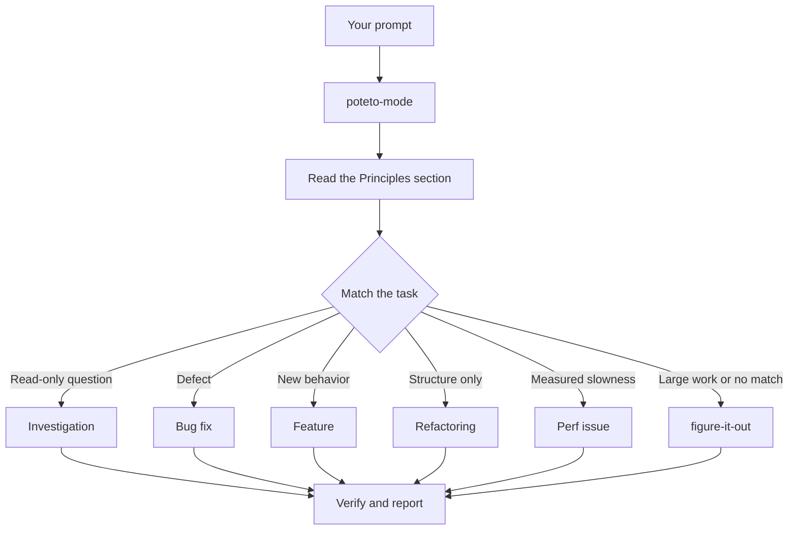

> 이 문서는 [02-poteto-mode.md](./02-poteto-mode.md)을 한국어로 번역한 문서입니다. 원본과 내용이 다르면 원본을 기준으로 합니다.

# `/poteto-mode`로 작업 라우팅하기

`/poteto-mode`는 작업을 시작하는 진입점입니다. 목표를 주면 스물세 개의 플레이북 중 하나와 매칭하고, 그 플레이북의 단계를 할 일 목록에 복사한 뒤, 단계에 필요할 때마다 다른 스킬을 호출합니다. 이 페이지에서는 좋은 프롬프트가 어떤 모습인지, 그리고 실제로는 프롬프트가 얼마나 짧아도 되는지 배웁니다.


## 프롬프트가 처리되는 과정



이 다이어그램은 자주 쓰이는 경로를 보여 줍니다. 이 밖에도 지표 힐클라이밍(hillclimbing), 런타임 증상과 캡처한 트레이스 진단, 프로토타입, 시각적 동일성(visual parity), 스킬 작성과 평가, 자율 실행, PR 열기, PR이나 스택을 병합 가능한 상태까지 돌보기, 검증된 스택 출시, PR 대기열이나 스택을 자동으로 처리하기, 프로젝트 규모의 프로그램 오케스트레이션, 세션 이어받기, 안전하게 일시 중지하기, 여러 단계로 된 계획, 워크트리 정리를 위한 플레이북이 있습니다. 전체 목록은 [플레이북 디렉터리](../../skills/poteto-mode/playbooks/)에 있습니다.

## 절차가 아니라 목표를 말하기

명세를 작성하지 않아도 됩니다. 무엇이 잘못되었는지 또는 무엇을 원하는지 말하고, 에이전트의 시간을 아껴 줄 이미 알고 있는 정보를 덧붙이면 됩니다.

```text
/poteto-mode 재시도 후에 사용자가 알림을 두 번 받아. 먼저 재현하고, 그다음 수정하고 검증해.
```

이것은 Bug fix 프롬프트입니다. "먼저 재현하고"(repro first)는 예의상 하는 말이 아니라 실제 제약 조건이며, 플레이북은 이를 지킵니다. 할 일 목록이 Bug fix 단계로 채워지는 것을 지켜보세요. 건너뛴 단계는 `skip: <reason>`과 함께 계속 보입니다.

## 프롬프트에 담을 내용

유용한 프롬프트는 최대 다섯 가지를 담으며, 각각은 한 문장이면 충분합니다.

- **목표.** 무엇이 잘못되었는지 또는 무엇을 원하는지 말합니다.
- **완료 확인 기준.** 통과하거나 실패할 수 있어야 합니다. "더 좋게 만들어"나 "한 시간 동안 작업해"는 확인 기준이 아닙니다.
- **보고 싶은 증거.** 실제 명령어 출력, 흐름을 녹화한 영상, 저장된 값, 또는 전후 수치를 요청합니다.
- **이미 알고 있는 것.** 증상, 재현 단계, 로그 한 줄, 링크가 있으면 에이전트가 검색할 필요가 줄어듭니다.
- **실제 제약 조건.** "먼저 재현하고"(repro first), "아직 코드는 변경하지 마"(don't change any code yet), "동작 변경 없음"(zero behavior change), "진행하기 전에 내가 리뷰할게"(let me review before proceeding)는 각각 에이전트가 하는 일을 바꿉니다.

다섯 가지를 모두 담은 프롬프트의 예는 다음과 같습니다.

```text
/poteto-mode 어제 배포 이후로 csv 내보내기에서 마지막 행이 빠져. 실패한 작업 id는 4812야. 먼저 재현하고, 그다음 수정해. 6만 행짜리 픽스처가 모든 행을 내보내면 완료야. 수정 전후의 행 수를 보여 줘.
```

빼 두는 편이 좋은 것이 두 가지 있습니다.

- **방법.** 무엇을 달성할지 말하고, 에이전트가 사용자가 고를 경로보다 더 나은 경로를 찾을 여지를 남겨 둡니다. 스킬 목록도 마찬가지이며, 아래의 함정 항목에서 다룹니다.
- **처음에는 원인에 대한 사용자의 추측.** 추측을 말하면 탐색 범위가 사용자가 가리킨 곳으로 좁혀집니다. 사용자의 짐작을 공유하기 전에 에이전트가 먼저 문제를 다시 설명하게 하세요.

긴 스레드나 모호한 버그처럼 잡음이 많은 보고라면, 다시 설명하기를 첫 단계로 둡니다.

```text
/poteto-mode 이 스레드를 읽어. 근본적인 문제를 네 말로, 쉬운 말로 다시 설명해. 아직 코드는 변경하지 마.
```

잘못 이해한 부분은 코드가 생기기 전에 다시 설명하는 단계에서 드러납니다. 그 자리에서 바로잡으면 잘못된 수정 하나 대신 메시지 하나만 들이면 됩니다. 플레이북 없이 다시 설명하기만 하려면 [`/in-your-own-words`](../../skills/in-your-own-words/SKILL.md)를 실행합니다. 이 스킬은 에이전트가 생각하는 사용자의 목표와 사용자가 해결하려는 문제를 다시 설명합니다.

작업 방향이 제대로 잡혔는지 확신이 없으면 작업 앞에 [`/sharpen`](../../skills/sharpen/SKILL.md)을 붙입니다.

```text
/sharpen v2 설정 형식에 대한 마이그레이션 가이드를 작성해.
```

시작하기 전에 에이전트는 최고 수준의 전문가라면 이 작업을 어떻게 할지, 사용자가 진짜로 원하는 것이 무엇인지, 요청이 지나치게 구체적이거나 부족하게 구체적이지 않은지를 따져 봅니다. 목표에 도움이 되는 제약 조건을 추가하는 만큼이나 목표에 도움이 되지 않는 제약 조건도 기꺼이 없애고, 사용자의 선택지는 열어 두며, 결과가 올바른지 확인할 외부 기준 하나를 유지합니다. 그런 다음 작업을 수행합니다.

## 후속 메시지는 짧게

대화에 이미 맥락이 담겨 있으면 프롬프트는 거의 없는 수준까지 줄어듭니다. 다음은 모두 충분합니다.

```text
/poteto-mode 해 줘
```

```text
계속해
```

```text
끝날 때까지 계속해
```

짧아도 되는 이유는 플레이북이 구조를 담고 있고, Custom Mode가 매 턴마다 `/poteto-mode`를 컨텍스트에 유지하기 때문입니다. 시작하는 방법은 [pstack 설정하기](./01-setup.md#run-your-first-task)에서 보여 줍니다. 사용자의 말은 의도를 전달하고, 스킬은 엄밀함을 담당합니다.

## "new task"로 작업 전환하기

긴 채팅에는 이전 작업의 맥락이 쌓입니다. 주제를 바꿀 때는 그렇다고 말하세요.

```text
/poteto-mode new task. 로그아웃 후에도 캐시 항목이 남아 있는 이유를 알아내. 아직 코드는 변경하지 마.
```

"new task"는 `/poteto-mode`에게 이전 플레이북을 계속하지 말고 다시 매칭하라고 알려 줍니다. "아직 코드는 변경하지 마"(don't change any code yet)는 이 작업을 Investigation에 고정합니다. 이 두 문구가 없으면 Feature 작업 도중인 모드는 사용자의 질문을 다음 기능 단계로 취급하는 경향이 있습니다.

## 병렬 작업에는 별도의 머신 주기

컴퓨터 한 대에서 저장소 하나를 대상으로 여러 에이전트를 실행하면, 에이전트들이 작업 트리, 포트, 빌드 결과물을 두고 충돌합니다. 가장 깔끔한 격리 방법은 [클라우드 서브에이전트](https://cursor.com/docs/subagents#cloud-subagents)입니다. 각 서브에이전트는 자체 VM과 브랜치를 받으므로, 사용자의 머신에 손대지 않고 의존성을 설치하고, 앱을 실행하고, 결과를 영상으로 녹화할 수 있습니다. 작업 앞에 `/in-cloud`를 입력하거나, 부모 채팅에 작업을 클라우드 서브에이전트에게 넘기라고 요청하세요.

작업을 로컬에서 해야 한다면 처음부터 워크트리를 요청합니다.

```text
/poteto-mode new task. 새 워크트리에서 <base>를 기준으로 브랜치를 만들고, 거기로 파서 변경 사항을 옮겨.
```

작업마다 자체 브랜치와 워크트리를 쓰면 어떤 에이전트도 다른 에이전트의 파일을 덮어쓰지 않습니다. 워크트리는 디스크와 머신 자원을 소모하므로, 노트북에서는 몇 개만 동시에 실행할 수 있습니다. [Opening a PR 플레이북](../../skills/poteto-mode/playbooks/opening-a-pr.md)은 코드 변경 시 이미 워크트리에서 작업하므로, 대부분은 특정 기준 브랜치나 위치가 중요할 때만 이것을 말하면 됩니다.

워크트리는 쌓입니다. 디스크 공간이 부족해지면 다음과 같이 요청합니다.

```text
/poteto-mode 내 디스크를 뭐가 차지하고 있어? 정리해도 안전한 워크트리는 정리해.
```

[Worktree cleanup 플레이북](../../skills/poteto-mode/playbooks/worktree-cleanup.md)은 모든 워크트리를 병합 상태, 커밋하지 않은 작업, 그리고 아직 그 워크트리를 건드리는 채팅을 기준으로 분류합니다. 그 증거로 안전하다고 확인된 것만 삭제하고, 커밋하지 않은 작업이 있는 워크트리는 사용자의 판단을 기다리며 멈춥니다.

## 실행해 두고 자리 비우기

자리를 비울 때는 완료가 무엇을 뜻하는지 말하고 떠나면 됩니다.

```text
/poteto-mode 나 잠깐 자리 비울게. 마이그레이션 검사에서 이전 호출자가 0개로 나올 때까지 계속해. 결정 사항은 기록해 둬.
```

나중에 리뷰할 작업은 [`/figure-it-out`](../../skills/figure-it-out/SKILL.md)으로 라우팅됩니다. 이 스킬은 실행 단계를 설계하고 [`/show-me-your-work`](../../skills/show-me-your-work/SKILL.md) 결정 로그를 유지합니다. 야간 작업에서 지켜야 할 약속 전체는 [잠자는 동안 작업 실행하기](./07-overnight.md)에서 다룹니다.

**함정:** 프롬프트에 스킬을 나열하지 마세요("use /how, then /architect, then /arena..."). 플레이북이 이미 순서를 정해 두었고, 직접 작성한 순서는 플레이북이 유지했을 단계를 뒤바꾸거나 빠뜨리는 경우가 많습니다. 특정 선택을 재정의하고 싶을 때만 스킬 이름을 지정하세요.

전체 라우팅 규칙은 [`poteto-mode`](../../skills/poteto-mode/SKILL.md) 자체를 읽어 보세요.

다음: [코드 이해하기](./03-understand.md).
