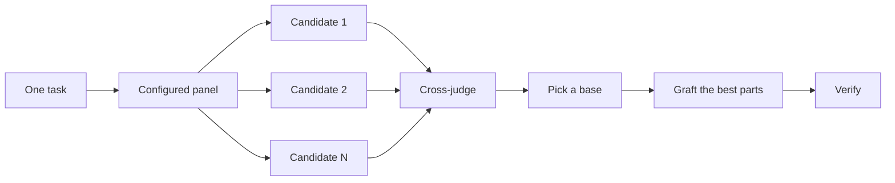

# 코드를 쓰기 전에 설계하기

> 이 문서는 [04-design.md](./04-design.md)를 한국어로 번역한 문서입니다. 원본과 내용이 다르면 원본을 기준으로 합니다.

어려운 설계를 한 번만 시도하면 모델이 처음 떠올린 형태로 굳어집니다. `/architect`는 구현 전에 타입과 경계를 확정합니다. `/arena`는 같은 요청에 대해 여러 번 시도하고 가장 좋은 부분을 합칩니다. `/interrogate`는 다른 모델들이 결과를 깨뜨려 보게 합니다. 작업의 목적이 설계 종합이 아니라 범위 커버리지라면, `/swarm`이 조각이나 경주를 병렬로 분산하고 결과를 취합합니다.

가장 흔한 설계 실수 두 가지는 에이전트가 처음 내놓은 설계를 그대로 받아들이는 것과, 어떤 코드로도 검증되지 않은 계획을 다듬는 것입니다. 이 페이지는 두 가지를 모두 해결합니다. 여러분은 코드를 통해 계획합니다. 프로토타입이 열린 질문에 답하고, README나 튜토리얼이 목표를 정하며, 문서로 된 계획은 마지막에 작성합니다.


## `/architect`로 형태 확정하기

```text
/architect 코드를 쓰기 전에 임포트 파이프라인을 설계해 줘. 나는 호출하는 쪽에서 어떻게 사용하는지가 가장 중요해.
```

[`/architect`](../../skills/architect/SKILL.md)는 먼저 근거를 확보합니다. 설계가 영향을 주는 코드에 대해 `/how`를 실행하고, 소유권이나 계층을 옮기는 경우에는 `/why`도 실행합니다. 그런 다음 `/arena`를 실행해 경쟁하는 설계 초안들을 만듭니다. 각 초안에는 호출하는 쪽의 사용법이 먼저 작성되고, 그 뒤에 타입, 시그니처, 모듈 지도가 이어집니다.

기본적으로는 종합된 설계에서 곧바로 구현으로 넘어갑니다. 설계를 먼저 보고 싶다면 그렇게 말하세요.

```text
/architect 체크포인트를 둬. 구현하기 전에 멈추고 나한테 보여 줘.
```

코드 작성이 시작된 뒤에는 설계를 절대적인 것으로 취급하지 않습니다. 구현 과정에서 서로 관련 없는 곳에 같은 우회책이 나타나거나, `any`나 강제 캐스트를 써야만 컴파일되는 타입이 나타나면, `/architect`는 이를 설계가 잘못되었다는 증거로 취급합니다. 그 주변을 땜질하는 대신 초안을 버리고 처음부터 다시 시작합니다.

## `/arena`로 여러 시도를 병렬로 분산하기

```text
/arena 내 프롬프트를 그대로 arena에 넣어 줘. 그들의 제안과 네 제안을 비교하고 싶어.
```

[`/arena`](../../skills/arena/SKILL.md)는 그 밑에 깔린 범용 도구입니다. N개의 서브에이전트가 같은 설계 또는 코드 요청을 병렬로 시도하며, 각자 자신의 워크트리나 디렉터리에 작성합니다. 읽기 전용 심판(설정이 허용하면 다른 모델 계열)이 모든 후보를 루브릭에 따라 채점합니다. 코디네이터는 각 후보를 처음부터 끝까지 읽고, 기반이 될 후보를 고르고, 탈락한 후보들의 가장 좋은 아이디어를 이식한 다음, 결과를 검증합니다.



패널은 여러분의 [`/setup-pstack`](../../skills/setup-pstack/SKILL.md) 설정에서 가져오며, 작업마다 조정할 수 있습니다. 결정이 중요하면 후보를 더 많이, 중요하지 않으면 더 적게 요청하세요.

```text
/arena 이거, 후보 5개로. 캐시 키 형식은 나중에 바꾸기가 비싸.
```

## `/swarm`으로 조각과 경주 커버하기

```text
/swarm packages/ 아래의 모든 패키지를 각자의 check.sh로 검사해 줘. 패키지마다 워커 하나. 보고서는 하나로.
```

[`/swarm`](../../skills/swarm/SKILL.md)은 N개의 워커를 독립된 조각, 커버리지 매트릭스, 건틀릿 레인, 탐색 파티션, 또는 선언된 경주 갈래에 병렬로 분산합니다. 각 워커는 자신의 범위와 검사를 받고, `PASS`, `ISSUES`, `BLOCKED` 중 하나를 보고합니다. 부모는 워커들을 기다린 뒤, 빠진 부분이나 중도 이탈을 포함한 간결한 보고서 하나를 돌려줍니다.

병렬 처리가 커버리지를 늘려 주거나 독립된 검사들을 경주시킬 수 있을 때 사용하세요. `/arena`는 모든 워커에게 같은 설계 또는 코드 요청을 준 다음, 기반을 고르고 가장 좋은 부분을 이식합니다. `/swarm`은 조각을 커버하거나, 미리 선언한 선택 규칙에 따라 경주를 실행합니다. 기반 선택과 이식 절차는 사용하지 않습니다.

## `/interrogate`로 깨뜨려 보기

```text
/interrogate 브랜치 전체를, 하지만 회의적으로 봐 줘. 실제 버그나 회귀가 아니면 사소한 지적은 하지 마.
```

[`/interrogate`](../../skills/interrogate/SKILL.md)는 같은 diff, 의도, 루브릭을 서로 다른 모델 계열의 리뷰어들에게 보냅니다. 핵심은 모델 다양성입니다. 모델마다 사각지대가 다르기 때문에, 두 모델이 독립적으로 제기한 지적은 신뢰도가 높은 신호입니다. 리드는 모든 지적을 `Act on`, `Consider`, `Noted`, `Dismissed`로 분류하고, 기각한 각 항목에 이유를 달며, 아무것도 자동으로 적용하지 않습니다.

기각된 항목도 읽어 보세요. 리드는 실용적인 시니어 엔지니어이지 무엇이든 아는 존재가 아니며, 여러분은 리드의 판단을 뒤집을 수 있습니다.

## 논쟁하는 대신 프로토타입 만들기

첫 번째 설계를 절대 그대로 받아들이지 마세요. 몇 가지를 요청하고, 눈으로 확인할 수 있는 증거를 바탕으로 고르세요.

```text
/poteto-mode 새 드롭다운 메뉴에 대한 옵션 몇 가지를 프로토타입으로 만들어 줘. 비교할 수 있게 스크린샷이나 영상을 찍어 줘.
```

[Prototype 플레이북](../../skills/poteto-mode/playbooks/prototype.md)은 임시 디렉터리에 버릴 초안들을 만들고, 변형들을 하나의 전환기 뒤에 두고, 각 변형을 직접 실행해 보며, 스크린샷이나 소요 시간을 수집합니다. UI뿐 아니라 동작과 알고리즘에도 사용할 수 있습니다. 프로토타입은 코드로 하는 계획입니다. 프로토타입을 쓰면 에이전트가 여러분에게 묻는 대신 무언가를 실행해서 스스로 열린 질문에 답할 수 있고, 여러분이 생각하지 못했을 선택지가 나올 여지도 생깁니다.

같은 방식은 실제 설계 규모로도 확장됩니다. `/architect`와 프로토타입을 함께 쓰고, 리뷰 관문을 유지하세요.

```text
/poteto-mode 외부 웹훅에 속도 제한이 필요해. 먼저 /architect로 설계하고, 열린 질문은 프로토타입으로 답해 줘. 진행하기 전에 내가 리뷰할게.
```

추상적인 계획에 리뷰어를 쓰지 마세요. `/interrogate`는 diff에 사용해야 합니다. 뒷받침하는 코드가 없는 계획에 적대적 리뷰를 맡기면, 리뷰어들은 절대 일어나지 않을 이론적 위험과 엣지 케이스를 지어냅니다. 프로토타입으로 질문을 정리한 다음, 실제로 만들어진 것을 리뷰하세요.

## 공유 코드라면 README를 먼저 작성하기

다른 코드가 사용할 패키지나 API라면, 사용자가 읽을 문서부터 시작하세요.

```text
/poteto-mode 새 config 패키지를 내가 어떻게 사용할지에 대한 튜토리얼을 먼저 써 줘. 그다음 /teach로 왜 그게 현재 패키지보다 나은지 가르쳐 줘.
```

튜토리얼을 먼저 작성하면 호출하는 쪽의 관점을 취할 수밖에 없습니다. 가상의 사용자에게 API를 설명하고, 거기서부터 거꾸로 구현까지 작업해 나갑니다. 문서는 에이전트가 자신의 작업을 비교해 확인하는 구체적인 목표가 되기도 합니다. 문서 자체가 중요할 때는 [`/technical-writing`](../../skills/technical-writing/SKILL.md)을 명시하세요. 그러면 튜토리얼이 레퍼런스와 설명을 한꺼번에 담는 방향으로 흐르지 않고 튜토리얼로 유지됩니다.

## 설계가 확정된 뒤에 계획하기

pstack에는 계획 스킬이 없으며, 이는 의도된 것입니다. 문서로 된 계획이 필요하다면, 설계가 확정된 뒤에 요청하세요.

```text
/poteto-mode 이 설계를 계획으로 바꿔 줘. 검증 가능한 작은 PR들로, 각 PR마다 자체 검증 단계를 넣어서.
```

[Multi-phase plan 플레이북](../../skills/poteto-mode/playbooks/multi-phase-plan.md)은 남아 있는 열린 질문을 프로토타입으로 해결한 다음, PR마다 한 섹션씩 작성하며, 각 섹션은 변경이 동작한다는 증명으로 끝납니다. 테스트 스위트 통과만으로는 그 증명으로 인정되지 않습니다. 계획이 결과물입니다. 이 플레이북은 계획을 구현하지 않으며, 다음에 어떤 실행 플레이북이 계획을 실행해야 하는지 명시합니다.

마이그레이션이라면 프롬프트에 기준을 명시하세요.

```text
/poteto-mode 우리 UI 라이브러리를 새 스타일링 시스템으로 마이그레이션하는 계획을 세워 줘. 검증 가능한 작은 PR들로, 각 PR마다 시각적 회귀 검사를 넣어서. 결과는 버그까지 포함해서 원본과 정확히 같아야 해.
```

"버그까지 포함해서"라는 말은 마이그레이션 도중에 몰래 무언가를 고치는 일을 막아 줍니다. 그런 수정이 생기면 이전 출력과 새 출력을 비교할 수 없게 됩니다. 여러 날에 걸친 프로젝트라면, 다른 에이전트들이 진행 중인 작업을 볼 수 있도록 계획을 한동안 저장소에 커밋해 둘 수 있습니다. 작업이 반영되면 삭제하세요.

## 작업에 설계를 얼마나 투자해야 할까요?

모든 변경에 이런 과정이 필요한지 궁금할 수 있습니다. 그렇지 않습니다. 대부분의 변경에는 이 중 어느 것도 필요하지 않습니다. 대략적인 단계는 다음과 같습니다.

- 확신이 서지 않는 작고 완성된 변경에는 `/interrogate`만 있으면 됩니다.
- 함수 경계를 넘거나 소유권을 옮기는 변경에는 `/architect`가 필요하며, `/architect`는 `/arena`를 함께 가져옵니다.
- 이름, 형식, 알고리즘처럼 독립적인 시도가 도움이 되는 단독 결정에는 `/arena`를 직접 사용합니다.
- 커버리지 매트릭스, 병렬 검사 묶음, 선언된 갈래가 있는 경주에는 `/swarm`을 사용합니다.
- 레이아웃, 소요 시간, 접근 방식처럼 무언가를 실행해서 답할 수 있는 열린 질문에는 논쟁이 아니라 프로토타입을 사용합니다.
- 논란이 있고 되돌리기 비싼 설계에는 `/architect`를 사용하고, 배포 전에 `/interrogate`를 사용합니다.
- 여러 PR에 걸친 작업에는 설계가 확정된 뒤에 작성한 계획을 사용합니다.

`/poteto-mode`는 이미 이 단계를 적용합니다. 경계를 넘는 작업은 자동으로 `/architect`를 실행하므로, 이 스킬들을 직접 호출하는 경우는 주로 기본값보다 더 많거나 더 적은 검토를 원할 때입니다.

다음: [변경 구현하고 정리하기](./05-build-and-clean.md).
