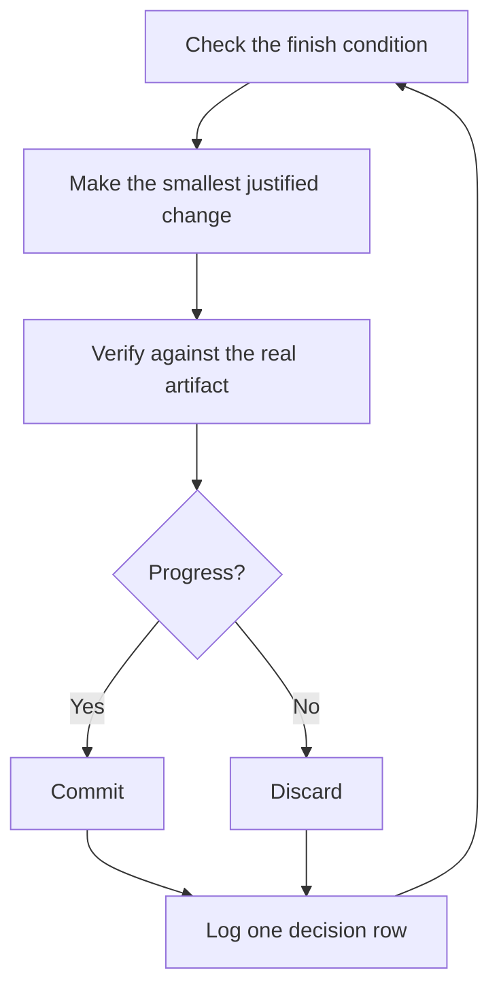

> 이 문서는 [07-overnight.md](./07-overnight.md)을 한국어로 번역한 문서입니다. 원본과 내용이 다르면 원본을 기준으로 합니다.

# 잠자는 동안 작업 실행하기

앞에서 다룬 모든 내용은 바로 이 단계를 위한 것입니다. 자기 작업을 스스로 검증한다고 믿을 수 있는 에이전트라면 어려운 작업을 맡기고 자리를 비워도 됩니다. 이것을 안전하게 만드는 것은 막연한 기대가 아닙니다. 확인 가능한 완료 조건, 격리된 워크트리나 클라우드 에이전트, 그리고 아침에 점검하는 결정 로그가 안전을 보장합니다.


## 루프를 돌리기 전에 신뢰를 먼저 확보하기

신뢰하지 못하는 루프는 확인되지 않은 작업을 더 빨리 만들어 낼 뿐이며, 반복할 때마다 문제가 누적됩니다. 루프를 켜 두고 자리를 비우기 전에, 그 루프가 그럴 자격을 갖추었는지 확인합니다.

- 작업을 직접 한 번 해 보았거나 에이전트가 하는 모습을 지켜보았기 때문에, 좋은 결과가 어떤 모습인지 알고 있습니다.
- 에이전트가 여러분이 직접 쓸 도구와 신호, 즉 검증 스킬, 프로파일러, 로그를 갖추고 있습니다.
- 모든 단계가 자기 작업을 증명하며, 작업이 기준에 미치지 못하면 라인을 멈출 수 있습니다.
- 트랜스크립트를 몇 개 읽어 보고, 반복되는 실패를 도구, 스킬, 또는 검사로 바꾸어 두었습니다.

네 가지가 모두 충족된 뒤에만 루프를 자율적으로 실행합니다. 그 전까지는 지켜보는 동안에만 실행합니다.

## 야간 작업 계약

좋은 인계에는 목표, 완료 조건, 권한, 그리고 탈출구가 들어 있습니다. 길 필요는 없습니다.

```text
/poteto-mode 나 이제 잔다. <base>에서 새 워크트리를 만들어서 모든 호출부를 새 파서로 마이그레이션해 줘.
완료 기준은 기존 호출부 0개, 모든 파서 fixture 통과, 기존 api 삭제야.
결정 로그를 남겨 줘. 커밋하기 전에 나한테 묻지 마.
완료될 때까지 /loop. 몇 시간이 지나도 정말 막혔으면 멈추고 이유를 정리해 줘.
```

각 줄이 어떤 효과를 주는지 차례로 살펴봅니다.

- "나 이제 잔다"는 세션 재정의입니다. 에이전트는 질문을 멈추고 계속 진행합니다.
- "완료 기준은..."은 목표를 매 반복마다 실행할 수 있는 검사로 바꿉니다.
- "`<base>`에서 새 워크트리"는 이 실행이 여러분이 열어 둔 다른 작업과 충돌하지 않게 합니다.
- "커밋하기 전에 나한테 묻지 마"는 에이전트가 기다리느라 멈출 권한 질문에 미리 답해 둡니다.
- `/loop`는 pstack 스킬이 아니라 Cursor에 내장된 깨우기 메커니즘입니다. [Autonomous run 플레이북](../../skills/poteto-mode/playbooks/autonomous-run.md)은 이것을 사용해 이벤트나 하트비트가 올 때마다 완료 조건을 다시 확인합니다.
- 탈출구가 있으면 에이전트가 진짜 막다른 길에서 멈추고 이유를 정리할 수 있습니다. 여덟 시간 동안 목표를 제멋대로 재해석하는 것보다 이편이 낫습니다.

여러분이 자리를 비운 뒤에 이 작업을 리뷰하게 되므로, `/poteto-mode`는 이 작업을 [`/figure-it-out`](../../skills/figure-it-out/SKILL.md)으로 보냅니다. 이 스킬은 코드를 작성하기 전에 실행 단계를 설계하고 결정 로그를 연결합니다.

실행을 의도적으로 멈추려면 에이전트에게 일시 중지하라고 말하거나, 곧 오프라인이 되거나 Cursor를 재시작할 것이라고 알립니다. [Pause safely 플레이북](../../skills/poteto-mode/playbooks/pause-safely.md)은 현재 단계를 마무리하거나 되돌리고, 진행 중인 작업을 체크포인트로 커밋하고, 재개용 메모를 작성합니다. 새 채팅은 Session pickup 플레이북을 통해 그 메모에서 작업을 이어받습니다. "계속해"라고 말하면 절대 일시 중지가 일어나지 않습니다.

## 루프가 밤새 하는 일



반복할 때마다 변경 하나, 검사 하나, 로그 한 행입니다. 도움이 되지 않은 변경은 그대로 남겨 두지 않고 폐기합니다. 정체 구간에 들어서면 멈추지 않고 방향을 바꾸며, 완료 조건을 슬그머니 완화해 성공을 선언하는 일은 절대 없습니다.

## 아침 점검

[`/show-me-your-work`](../../skills/show-me-your-work/SKILL.md)가 있기 때문에 실행을 리뷰할 수 있습니다. 각 행에는 시간, 단계, 결정, 이유, 증거 위치, 결과가 기록되며, 이 내용은 `decisions.tsv`(여러 실행이 한 디렉터리를 공유하면 `.audit/<task-slug>.tsv`)라는 TSV 파일에 저장됩니다. 기본적으로 이 파일은 로컬에만 남습니다. 작업 규모가 커서 리뷰어가 결과를 신뢰하려면 기록이 필요할 때는 이 파일을 커밋합니다.

돌아오면 실행 내용을 리뷰 형식으로 요청합니다.

```text
/show-me-your-work 어젯밤에 한 일 정리해서 알려 줘
```

스킬은 요약을 돌려주기 전에 다른 모델 계열의 리뷰어를 띄워 기록과 트랜스크립트를 읽게 하며, 답변은 여러분이 자세히 살펴봐야 할 항목을 나열한 Attention 섹션으로 끝납니다. 이 섹션을 먼저 읽고, 그다음 섹션이 가리키는 로그 행을 읽습니다. 여러분은 밤새 일어난 일을 전부 다시 읽는 것이 아니라 결정을 점검하는 것입니다.

점검 대신 빠른 상태 확인만 원한다면, 작업을 실행한 채팅에서 [`/ketchup`](../../skills/ketchup/SKILL.md)을 실행합니다. 이 스킬은 읽기만 하며, 마지막 메시지 이후 무엇이 바뀌었는지 작업 중에 만든 스크린샷과 작은 다이어그램을 곁들여 쉬운 말로 알려 줍니다. 그런 다음 병합, 승인, 여러 선택지 중 하나를 고르는 일처럼 여러분의 판단을 기다리는 사안을 하나씩 나열하고, 각각에 대해 에이전트의 선택, 증거, 위험을 함께 보여 주므로 답변만 보고도 결정할 수 있습니다.

## 밤 동안 작업 하나가 아니라 대기열을 처리할 때

위의 계약은 작업 하나를 완료 조건 하나까지 끌고 갑니다. 어떤 밤에는 독립적인 변경들로 이루어진 대기열이나 프로그램 전체처럼 더 많은 일을 처리해야 합니다. 세 가지 플레이북이 같은 신뢰 구조를 더 큰 규모로 확장합니다.

[Autopilot-full](../../skills/poteto-mode/playbooks/autopilot-full.md)은 독립적인 PR들로 이루어진 대기열을 병합까지 진행합니다. 각 PR에는 빌드부터 병합까지 책임지는 소유자 에이전트가 하나씩 배정되며, 어떤 소유자도 자기 판정만으로 병합하지 않습니다. 새로 띄운 검증자 무리가 소유자의 코드 준비 완료 헤드를 검사합니다. 이후의 리베이스나 사소한 수정에는 새 검증자 하나만 붙고, 새로운 동작이나 큰 새 diff가 있을 때만 전체 검증자 무리를 다시 부릅니다. 실제로 병합되는 패치에 대한 깨끗한 판정만이 병합을 승인합니다.

```text
/poteto-mode 이 대기열을 full autopilot으로 처리해 줘. 각 항목은 독립적이야. 아침까지 병합돼 있으면 좋겠어.
```

[Autopilot-stack](../../skills/poteto-mode/playbooks/autopilot-stack.md)은 같은 소유자 루프를 실행하지만 아무것도 배포하지 않습니다. 아침에 일어나면 베이스 브랜치 위에 선형으로 쌓인 스택 하나가 있고, 각 단계마다 검증자의 판정이 붙어 있으며, 여러분이 직접 리뷰하고 반영합니다. 변경들이 서로 얽혀 있거나, 무엇이든 병합되기 전에 직접 작업을 확인하고 싶을 때는 Autopilot-full 대신 이것을 선택합니다.

```text
/poteto-mode 이 다섯 개 변경을 autopilot으로 처리하되 스택으로 쌓고 배포는 하지 마. 스택은 아침에 내가 반영할게.
```

[Orchestrate](../../skills/poteto-mode/playbooks/orchestrate.md)는 에이전트 하나의 수명보다 오래 가는 프로그램을 위한 플레이북입니다. 여러 날에 걸쳐, 쌓인 PR이 많고, 상주하는 코디네이터 채팅 하나 아래에서 서브에이전트 여러 무리가 일하는 경우입니다. 코디네이터는 작업 지시서를 작성하고, 서브에이전트가 끝낸 결과를 수집하고, 아직 병합되지 않은 가장 아래 PR을 통과 상태로 유지하며, 코드는 직접 작성하지 않습니다. 이 플레이북은 의도적으로 무겁게 만든 장치입니다. 에이전트 하나가 한 세션 안에 끝낼 수 있는 작업이라면, 플레이북 스스로 여러분을 위의 야간 작업 계약으로 되돌려 보냅니다.

```text
/poteto-mode 스토어 마이그레이션을 orchestrate해 줘. 모든 패키지가 변환되고 병합될 때까지 책임지고 맡아 줘. 나는 하루에 두 번 확인할게.
```

## 여러 프로젝트를 병렬로 실행하기

[Cursor Project](https://cursor.com/blog/projects)는 코디네이터 에이전트 하나에게 지속되는 스레드를 제공합니다. 코디네이터는 코드를 작성하지 않습니다. 코디네이터는 서브에이전트를 지휘하며, 서브에이전트는 기본적으로 클라우드에서 실행되므로 노트북을 닫아도 작업이 계속됩니다. 이것이 Orchestrate 플레이북이 기대하는 구조입니다. 코디네이터에게 보내는 프롬프트를 `/poteto-mode`로 시작하면, 코디네이터가 띄우는 서브에이전트들이 플레이북을 따릅니다.

도움이 되는 습관이 몇 가지 있습니다.

- 기능, 마이그레이션, 성능 개선, 기술 부채 정리처럼 작업 덩어리마다 별도의 Project를 둡니다. 여러 Project를 나란히 실행할 수 있습니다.
- 관련된 채팅을 끝난 것까지 포함해 Project로 끌어다 놓습니다. 그 채팅들은 Project 안의 모든 에이전트에게 컨텍스트가 됩니다.
- 각 PR이 병합되기 전에 검증 무리를 붙이고, 대기열은 Autopilot-stack이나 Autopilot-full이 처리하게 합니다.
- 코디네이터에게 데이터로 뒷받침되는 계획을 요청하고, 여러분에게 묻기 전에 열린 질문에는 프로토타입으로 답하게 합니다.

프롬프트 하나로 조사부터 실행까지 Project 전체를 이끌 수 있습니다.

```text
/poteto-mode 이 저장소의 아키텍처가 에이전트 친화적이 되도록 리팩터링해 줘. 과거 커밋과 리뷰 코멘트에 /correct와 /architect를 사용해서 이 저장소에서 에이전트가 가장 자주 저지르는 실수를 찾아 줘. 과거 채팅의 컨텍스트는 /recall로 가져와. 열린 질문은 나한테 묻지 말고 프로토타입으로 답해. 실제 데이터로 뒷받침되는 계획을 가지고 돌아와. 내가 승인하면 autopilot-stack이나 autopilot-full로 실행하되, 어느 쪽으로 할지 나한테 물어봐.
```

## 루프가 스스로 시작하게 하기

위의 모든 루프는 여전히 여러분이 시작해 주기를 기다립니다. 예약 실행이나 이벤트 기반 자동화를 쓰면 그 단계가 사라집니다. 소프트웨어 유지보수는 이런 방식에 잘 맞는 단계들로 나뉩니다. 보고를 분류하고, 재현하고, 고치고, 수정 내용을 검증하는 단계입니다. 두 가지 규칙이 이런 라인을 신뢰할 수 있게 유지합니다.

- 모든 단계가 라인을 멈출 수 있습니다. 분류 단계는 보고된 내용이 예상된 동작이라고 판단할 수 있고, 재현 단계는 재현에 실패할 수 있으며, 수정 담당은 변경이 너무 위험하다고 판단할 수 있습니다. 이런 결과는 모두 유용합니다. 잘못된 작업이 되돌리는 비용이 더 큰 다음 단계로 넘어가지 않게 막아 주기 때문입니다.
- 모든 단계가 증거를 넘겨줍니다. 재현 단계는 고장 난 상태의 스크린샷과 영상을 첨부하고, 수정 단계는 수정 전후를 보여 주는 증거를 첨부합니다. 그러면 사람(사용자)은 코드를 한 줄도 읽기 전에 에이전트가 올바른 것을 고쳤는지 확인할 수 있습니다.

pstack은 이것을 Slack 이슈 보고용 휴면 상태의 [자동화 팩](../../automations/benny/README.md)으로 제공합니다. 한 자동화는 각 보고를 분류합니다. 다른 자동화는 확인된 버그를 재현하고, 작은 초안 수정을 준비할 수도 있습니다. 설정하려면 에이전트에게 [`FOR_AGENTS.md`](../../automations/benny/FOR_AGENTS.md)를 알려 주고 대상 저장소를 지정합니다.

**함정:** 기간은 완료 조건이 아닙니다. "이걸 4시간 동안 작업해"라는 지시는 에이전트에게 확인할 거리를 하나도 주지 않으며, 아침에 일어나면 결과 대신 네 시간 동안 움직이기만 한 흔적을 보게 됩니다. `/loop`에는 통과하거나 실패할 수 있는 조건식을 주어야 합니다.

다음: [원칙 이름으로 방향 잡기](./08-principles.md).
